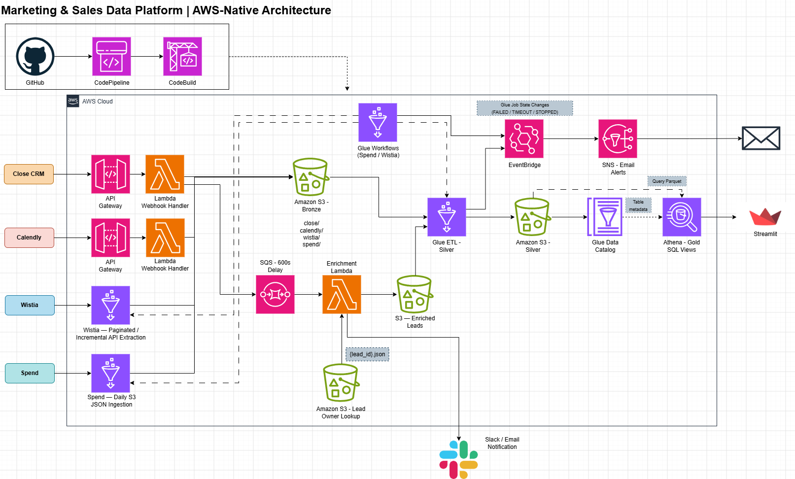

# Marketing–Sales Data Platform

An AWS-native, end-to-end data engineering platform integrating CRM, scheduling, video engagement, and advertising spend data into a centralized Amazon S3 data lake.

The platform demonstrates event-driven ingestion, asynchronous enrichment, scheduled API extraction, dependency-aware workflow orchestration, PySpark transformations, SQL-based analytical modeling, CI/CD, and operational monitoring.

**Status:** Implemented and validated end-to-end, including a locally running Streamlit dashboard.

## Architecture



The platform follows a medallion architecture with physically persisted Bronze and Silver datasets and a logical Gold layer implemented through Amazon Athena SQL views.

| Layer | Technologies | Purpose |
|---|---|---|
| Ingestion | API Gateway, Lambda, Glue Python Shell | Capture webhook events and retrieve source data |
| Enrichment | SQS, Lambda, external HTTP lookup, Slack | Enrich CRM leads and notify operational teams |
| Bronze | Amazon S3, JSON | Preserve source-oriented records |
| Orchestration | AWS Glue Workflows, scheduled and conditional triggers | Coordinate ingestion and downstream transformations |
| Silver | AWS Glue, PySpark, S3 Parquet | Standardize, validate, and deduplicate data |
| Catalog | AWS Glue Data Catalog | Register Silver datasets for SQL access |
| Gold | Amazon Athena, SQL views | Define reusable analytical metrics and cross-source relationships |
| Dashboard | Streamlit, PyAthena | Query and visualize analytical results |
| Monitoring | Amazon EventBridge, SNS | Route Glue job failure notifications to email |
| CI/CD | GitHub, CodePipeline, CodeBuild, S3 | Synchronize source scripts to deployment storage |

See [Architecture Documentation](docs/02_architecture.md) for implementation details and design decisions.

## Data Sources

- **Close CRM:** Lead creation events, contact attributes, and enrichment data.
- **Calendly:** Booking events, invitee details, and employee assignments.
- **Wistia:** Video metadata, cumulative engagement statistics, and visitor activity.
- **Advertising spend:** Daily marketing expenditure by channel.

## Implemented Features

### Event-Driven Ingestion

Close CRM and Calendly events enter through API Gateway and Lambda.

Close lead events are stored in Bronze and sent to an SQS queue with a 10-minute delay before enrichment. The enrichment Lambda retrieves additional lead-owner information, writes enriched records to S3, and sends Slack notifications.

### Scheduled Ingestion and Orchestration

AWS Glue Python Shell jobs retrieve Wistia API data and advertising spend records.

Wistia ingestion handles paginated visitor events and overlapping extraction windows. Advertising spend ingestion skips files already present in Bronze.

Two AWS Glue Workflows orchestrate the Spend and Wistia pipelines:

- Scheduled triggers initiate Bronze ingestion.
- Conditional triggers start the corresponding Silver transformation after successful ingestion.

Close and Calendly use event-driven Bronze ingestion with independently scheduled daily Silver transformations.

### Silver Transformations

Four AWS Glue PySpark jobs produce Parquet datasets for:

- Close leads
- Calendly bookings
- Advertising spend
- Wistia media, statistics, and visitor events

Transformations standardize source fields, normalize data types, remove duplicates, and apply dataset-specific validation rules.

Silver transformations use a full-refresh strategy appropriate to the project's dataset sizes and retained Bronze history.

Six Silver datasets are registered in the AWS Glue Data Catalog and queryable through Athena.

### Gold Analytical Layer

Gold is implemented as reusable Athena SQL views over cataloged Silver datasets, rather than as separately materialized S3 tables.

The implemented views are:

| Athena View | Purpose |
|---|---|
| `gold_daily_bookings` | Daily booking volume using Eastern Time |
| `gold_employee_workload` | Meeting volume and scheduled hours by employee |
| `gold_booking_patterns` | Booking distribution by weekday and hour |
| `gold_booking_attribution` | Booking distribution by normalized UTM source |
| `gold_funnel_conversions` | Email-matched Close leads and Calendly bookings by funnel |

The funnel conversion model deduplicates lead identities and requires booking creation to occur after lead creation.

Attribution reporting is limited by source tracking completeness. Funnel-level booking rates represent observed matches, not verified causal advertising attribution.

Because Gold uses virtual views, analytical results are computed at query time rather than maintained as separate Gold datasets.

### Streamlit Dashboard

A lightweight Streamlit application connects to Amazon Athena through PyAthena.

The dashboard includes:

- Daily booking trends and total bookings
- Lead-to-booking funnel conversion metrics
- Employee meeting workload
- Total advertising spend, daily spend, and spend by channel
- Lead acquisition volume and observed booking rates by funnel

The application reads from the existing Athena views and Silver tables without requiring additional transformation infrastructure.

### Monitoring and Alerting

Amazon EventBridge monitors Glue job state-change events across the six ingestion and transformation jobs.

Events with states `FAILED`, `TIMEOUT`, or `STOPPED` are routed to a dedicated Amazon SNS topic with an email subscription.

SNS notification delivery has been tested. End-to-end delivery from an actual Glue failure event has not yet been tested.

### CI/CD

AWS CodePipeline and CodeBuild synchronize source scripts from GitHub to S3.

Glue jobs configured to reference these script locations can use updated code on subsequent executions. Lambda package deployment is handled separately.

## Testing and Validation

The repository includes automated tests for:

- Calendly webhook ingestion
- Close webhook ingestion and SQS delivery
- Close lead enrichment and notification

Tests use mocked external services and fictional data; no live AWS credentials are required.

Run from the project root:

```bash
python -m pip install -r requirements.txt
python -m pytest tests/ -v
```

Additional validation was performed through Athena against the Silver datasets.

Checks confirmed:

- All six Silver tables were populated and queryable.
- Close leads and Calendly bookings contained no missing or duplicate primary keys.
- Both datasets contained no missing email addresses or required creation timestamps.

These are point-in-time validation results rather than automated data-quality gates.

## Running the Dashboard

Install the project dependencies:

```bash
python -m pip install -r requirements.txt
```

Configure AWS credentials with access to Athena, the Glue Data Catalog, and the relevant S3 locations.

The dashboard uses the `marketing_sales` Athena database in `us-east-1`. The Athena query-results location must be configured for the target AWS account.

Start the application from the project root:

```bash
streamlit run dashboard/app.py
```

The application runs locally and queries the AWS-hosted datasets.

## Repository Structure

```text
src/
├── ingestion/
├── enrichment/
└── transformations/

tests/
docs/
notebooks/
dashboard/
buildspec.yml
requirements.txt
.env.example
README.md
```

Exploratory notebooks document source-data inspection. Local source samples, credentials, and generated build artifacts are excluded from version control.

## Configuration and Security

Runtime configuration is supplied through Lambda environment variables, Glue job parameters, and AWS Secrets Manager.

The repository excludes local credentials and potentially sensitive source records. `.env.example` provides configuration placeholders.

Dashboard screenshots containing proprietary business information are not published.

This is a portfolio implementation. A production deployment would require additional security validation, webhook authentication review, automated data-quality enforcement, and source-specific operational controls.

## Project Documentation

- [Architecture and Design Decisions](docs/02_architecture.md)
- [Exploratory Data Findings](docs/03_eda_findings.md)