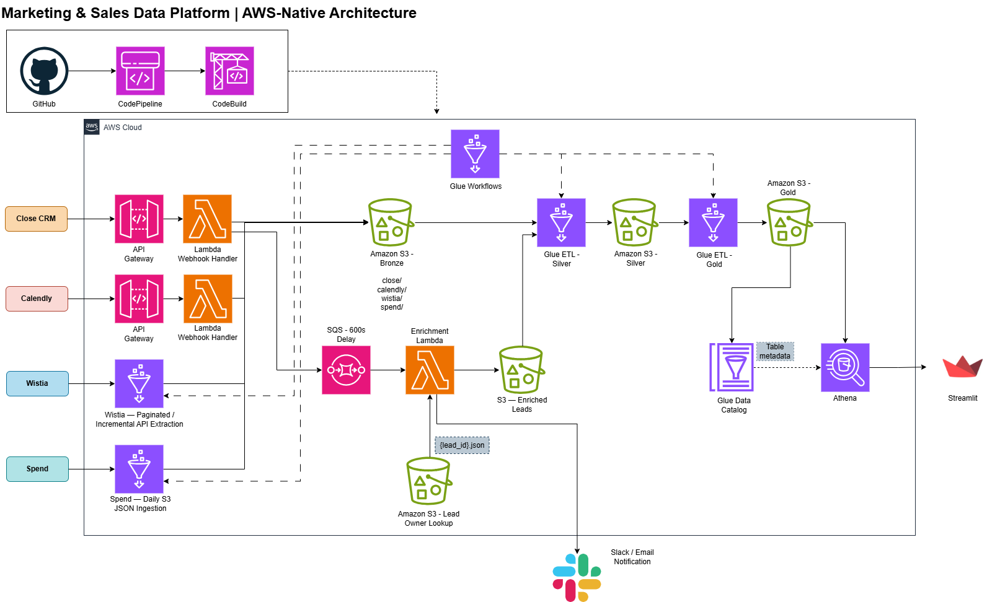

# Marketing–Sales Data Platform

An AWS-based, event-driven data engineering platform integrating CRM, scheduling, video engagement, and advertising spend data into a centralized S3 data lake.

The project demonstrates webhook ingestion, asynchronous enrichment, scheduled API extraction, PySpark transformations, and CI/CD deployment using AWS-native services.

**Status:** Bronze ingestion, Close lead enrichment, and Silver transformations implemented. Gold analytics and dashboard development are in progress.

## Architecture



The platform follows a Bronze/Silver architecture, with a Gold reporting layer planned.

| Layer | Technologies | Purpose |
|---|---|---|
| Ingestion | API Gateway, Lambda, Glue Python Shell | Capture webhook events and retrieve source data |
| Enrichment | SQS, Lambda, external HTTP lookup, Slack | Enrich CRM leads and notify operational teams |
| Bronze | Amazon S3, JSON | Preserve source-oriented records |
| Silver | AWS Glue, PySpark, Parquet | Standardize, validate, and deduplicate data |
| Gold (planned) | Athena, SQL | Produce reporting-ready metrics |
| Dashboard (planned) | Streamlit | Visualize booking and acquisition performance |
| CI/CD | GitHub, CodePipeline, CodeBuild, S3 | Synchronize source scripts to deployment storage |

See [Architecture Documentation](docs/02_architecture.md) for implementation details and design decisions.

## Data Sources

- **Close CRM:** Lead creation events, contact attributes, and enrichment data.
- **Calendly:** Booking events, invitee details, and employee assignments.
- **Wistia:** Video metadata, cumulative engagement statistics, and visitor activity.
- **Advertising spend:** Daily marketing expenditure by channel.

## Implemented Features

### Event-driven ingestion

Close CRM and Calendly events enter through API Gateway and Lambda.

Close lead events are stored in Bronze and sent to an SQS queue with a 10-minute delay before enrichment. The enrichment Lambda retrieves additional lead-owner information, writes enriched records to S3, and sends Slack notifications.

### Scheduled ingestion

AWS Glue Python Shell jobs retrieve Wistia API data and advertising spend records.

Wistia ingestion handles paginated visitor events and overlapping extraction windows. Advertising spend ingestion skips files already present in Bronze.

### Silver transformations

Four AWS Glue PySpark jobs produce Parquet datasets for:

- Close leads
- Calendly bookings
- Advertising spend
- Wistia media, statistics, and visitor events

Transformations standardize source fields, normalize data types, remove duplicates, and apply dataset-specific validation rules.

### CI/CD

AWS CodePipeline and CodeBuild synchronize source scripts from GitHub to S3.

Glue jobs configured to reference these script locations can use updated code on subsequent executions. Lambda package deployment is currently handled separately.

## Testing

The repository includes automated tests for:

- Calendly webhook ingestion
- Close webhook ingestion and SQS delivery
- Close lead enrichment and notification

Tests use mocked external services and fictional data; no live AWS credentials are required.

Run from the project root:

```bash
python -m pip install -r requirements.txt
python -m pytest tests/ -v
```

## Repository Structure

```text
src/
├── ingestion/
├── enrichment/
└── transformations/

tests/
docs/
notebooks/
dashboard/
buildspec.yml
requirements.txt
.env.example
```

Exploratory notebooks document source-data inspection. Local source samples, credentials, and generated build artifacts are excluded from version control.

## Planned Analytics

The next phase will register Silver datasets in the AWS Glue Data Catalog, query them with Athena, and develop Gold reporting datasets supporting:

1. Daily calls booked by source
2. Cost per booking by channel
3. Booking trends over time
4. Channel attribution leaderboard
5. Booking volume by time slot and day of week
6. Meeting load per employee

A lightweight Streamlit dashboard will present the available metrics.

Cross-source attribution will depend on the identifiers and tracking information available in the underlying data.

## Configuration and Security

Runtime configuration is supplied through Lambda environment variables, Glue job parameters, and AWS Secrets Manager.

The repository excludes local credentials and potentially sensitive source records. `.env.example` provides configuration placeholders.

This is a portfolio implementation. Production deployment would require additional security validation, webhook authentication review, monitoring, and source-specific operational controls.

## Project Documentation

- [Architecture and Design Decisions](docs/02_architecture.md)
- [Exploratory Data Findings](docs/03_eda_findings.md)